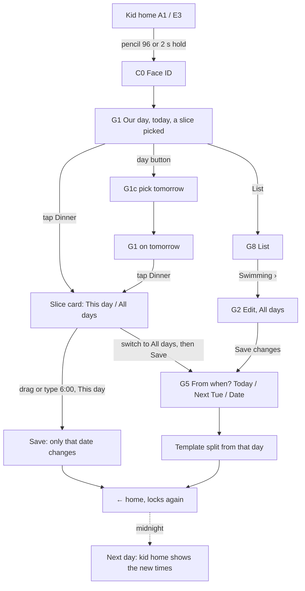

# UX flow review: a grown-up changes a repeating thing from tomorrow, a kid finds it the next day

Design session, 2026-11-22. This review asks for the harness test proposal
(`docs/superpowers/plans/2026-11-22-test-harness-review-proposal.md`, "UX between kid mode and
grown-up mode"), first part: the flow and the review. The review was done on the boards and the spec
only, without the driver's action list, so it tests what the screens themselves tell a grown-up.
Nobody has run it on the iPad yet; the observations at the end are what that run should record.

- **Boards**: G0, G1, G1c, G1d (layout v65–v66), G2, G5 (v61), G8 (v56), home A1 / E3 (v68).
- **Spec**: `2026-11-07-m2-screens-spec.md` at develop e25a7be: "Repeats, dates and changes", "Grown-up mode", "C0 · Grown-up lock", "Now and next on home".
- **Code read for the open questions**: `OurDayFeature` and `ItemEditorFeature` (G5), `HomeFeature` (home).

## The task

Two versions, because the app has two kinds of repeating things:

- **T1 (day template)**: "From tomorrow, dinner is at 6:00 pm on school days, not 6:30."
- **T2 (every-week item)**: "From next week, swimming moves from 3:30 pm to 4:00 pm."

The next morning, Kid A (7) and Kid B (2) open home with no help.

## The flow as designed

The right path for T1 is G1 → Dinner → **All days** → change the time → Save → G5 → "Next Tue"
(or Date) → Save. For T2 it is G1 → List → Swimming → G2 (All days) → time → Save changes → G5 →
"Next Mon" or Date → Save.

## Findings, ranked

### 1. G5 ignores the day on the clock (likely wrong-day save)
A grown-up who thinks "from tomorrow" will most naturally first move the clock to tomorrow (G1c).
Then they switch the card to All days and save. G5 still opens on **"Today"**: `OurDayFeature.fromWhen`
defaults to `.today`, and `allDaysFrom` counts from the real today, not from the shown `day`. Saving
straight through changes the template from today, so tonight's dinner on the clock and on the kid's home
moves too. The spec does not say which day G5 starts from.

**Proposal**: when the clock shows a day after today, G5 opens on that day: the "Date" tab picked with
the shown date. On today it keeps "Today". *Needs the user's OK.*

### 2. "Next Tue" can read as next week
G5's middle tab says "Next {weekday}" for the first day after today in the series. On a Monday, for a
Mon–Fri template, it reads "Next Tue" and means tomorrow. Many people read "next Tuesday" as the Tuesday
of next week. The grown-up then picks "Date" and has to find the right chip, or saves the wrong day.

**Proposal**: name the day itself. Use "Tomorrow" when it is tomorrow, otherwise the short date
("Wed 25 Nov"), not "Next Wed". *Needs the user's OK; it changes board G5's tab text.*

### 3. Two minutes without a touch drops Our Day's unsaved changes
C0's relock rule (proposed) discards unsaved form changes after 2 minutes without a touch, and at once
when the app goes to the background. On G1 every drag waits for Save, so a grown-up who answers the
door, or a phone call that sends the app to the background, loses several clock edits with no question.
G1d ("Save the changes?") covers leaving with "←", not the relock.

**Proposal**, one of:
- (a) keep G1's unsaved changes until the next unlock on the same day, and show G1d on return;
- (b) keep the rule but stretch the clock screens to 5 minutes.

*Needs the user's call.*

### 4. G2 and G5 boards still say "Back to Our kids" and "Grown-ups only"
"Our kids" was the C1 hub, which G6 Settings and G1 replaced. The header rule for grown-up screens is
"←" plus the screen title, with no caption. A grown-up arriving from G8 sees a back label naming a
screen that no longer exists.

**Proposal**: fix the boards to "←" + "Edit Swimming" (back to where they came from, G8 or G1), then
re-export the layout. This is a board cleanup, no decision.

### 5. The C0 section contradicts G0 and G1
C0 still places the pencil as a `RoundButton` 80 at x 1260, y 44, and gives the grown-up header as
"Undo and Settings". G0 (built) says 96 at 1240–1336, y 36–132. G1's header is List · Settings, with
Undo / Redo by the clock.

**Proposal**: C0 keeps only Face ID and relock, and points at G0 / G1 for the button and the header.
Doc cleanup.

### 6. The E5 section still shows the old side column
It has "Changes start from the next one.", "Skip just {date}", and the sentence "Removed by mistake?
Add it back from Our kids.". The last is an explanatory sentence, which the screens rule out, and it
names the retired hub. G2 is the screen now.

**Proposal**: fold into local issue 015 (rename E5 / C6 headings and fix their text).

### 7. When home shows a change is defined, but one line is missing
A change from tomorrow is invisible today, and the clock's day changes at midnight (spec "midnight"),
so the next morning is defined. What the spec does not say is that home shows a change from **today**
as soon as the grown-up returns. The built app does: `AppFeature` sends `home(.reload)` after each
grown-up save, and home stays under the grown-up screens in the navigation stack.

**Proposal**: one spec line under "Now and next on home": "A saved change shows on home when the
grown-up returns; there is no reload."

### 8. The kid's side the next morning
- **Kid A** sees the new dinner time on the clock as soon as dinner is the current or next thing: as
  the Next row ("Dinner / in 45 min"), and as the hub when it starts. Before that it is only a slice on
  the clock with no time printed. Whether a 7-year-old reads a moved slice as "dinner is earlier" is
  the question for the iPad run, not something the boards can answer.
- **Kid B** (2) has no clock and sees only the Now and Next rows (#216), so the change reaches Kid B
  only when it becomes Now or Next. That is the intent for a 2-year-old; no change proposed.

## The alternative to compare

The proposal suggests the grown-up sets the date range first from the List, then previews on the
clock. For T2 that path already half exists: G8 → G2 has **Runs** ("{start}" → "End of term"), and
moving Runs' start is a "from when" of its own. For T1 there is no List row, because day-template slots
are not listed.

Hypothesis, not tested: finding 1's fix (G5 follows the shown day) gets most of the benefit of
"date first" without a new screen. On the iPad, run both T1 paths and compare wrong-day saves.

## What to observe on the iPad, and what each result changes

| Observe | If… | Then |
|---|---|---|
| T1: does the grown-up go to tomorrow on G1c before editing? | most do | Finding 1 is needed (G5 follows the shown day). |
| T1/T2: in G5, does "Next Tue" read as tomorrow? | any reads it as next week | Finding 2 (name the day). |
| After Save, can the grown-up say which days changed? | no | Show the split day in G1d's line ("Dinner 6:00 pm, from Tue 24 Nov"). |
| Does anyone step away for over 2 minutes mid-edit? | yes, and loses edits | Finding 3 (a) or (b). |
| Next morning, Kid A: "When is dinner today?" with home only | can't point at it | Consider "until" or the time on the Next row for template slots; revisit with the user. |
| Next morning, Kid B: notices nothing | expected | No change. |

Kids' understanding and preference are judged from watching them use the app, not from this review.

## Done here, and left
- This note is the flow and the review (proposal output 1).
- Findings 4 and 5 are mechanical and go in a follow-up design PR. Finding 6 goes with issue 015.
  Findings 1–3 wait for the user's call.
- Finding 7 is one spec line, in the same follow-up.
- The Swift journey (proposal output 2: the past stays, the new times appear from the split day on
  the kid's home) belongs to the main session once findings 1–2 are decided.
